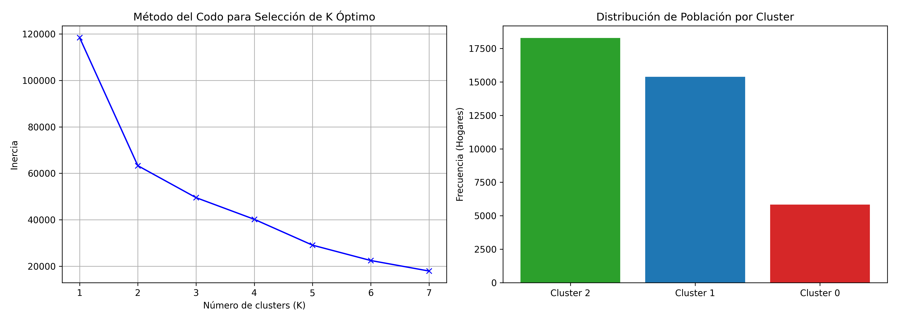
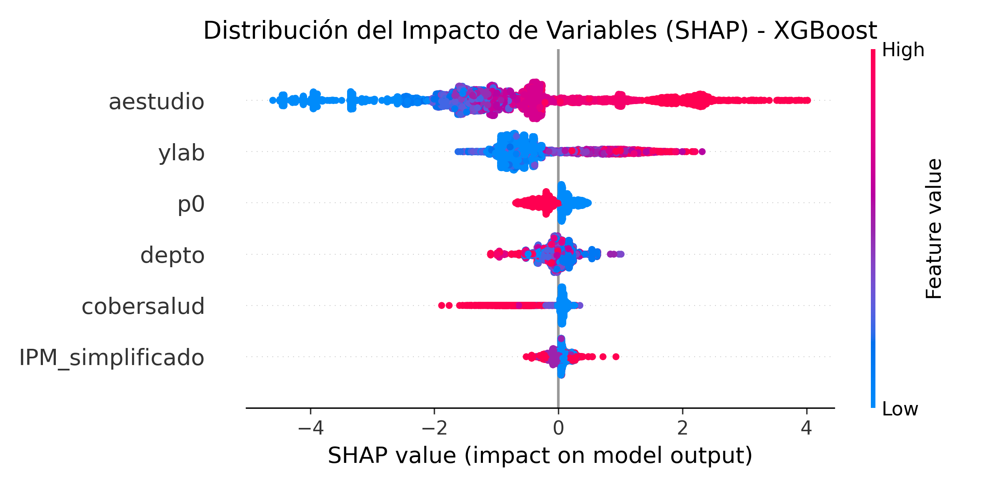
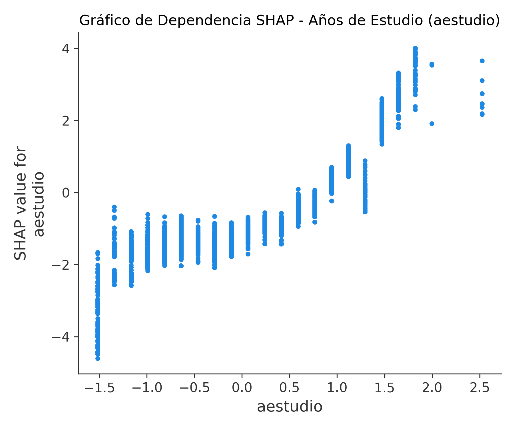

## Portada y Citación Obligatoria
Este reporte presenta la caracterización del mercado laboral boliviano mediante la integración de analítica avanzada de datos y machine learning.

* **Cita Obligatoria:**
  *Fuente: Instituto Nacional de Estadística, Encuesta de Hogares 2025 - [http://anda.ine.gob.bo/index.php/catalog/256](http://anda.ine.gob.bo/index.php/catalog/256)*

---

## Sección 1: Hallazgos Clave, Patrones y Segmentación Socioeconómica

El análisis descriptivo y de agrupamiento no supervisado revela heterogeneidades críticas a nivel geográfico y social en Bolivia:

1. **Distribución Geográfica de la Informalidad:** El mapa de informalidad promedia tasas superiores al 84% en todo el territorio nacional, alcanzando niveles alarmantes cercanos al 89% en departamentos como Pando, Beni y Oruro. Esto evidencia que la informalidad no es un fenómeno aislado de la ruralidad, sino una característica estructural dominante del mercado laboral boliviano.
2. **Deconstrucción Empírica de los Clusters (K-Means):** Utilizando el método del codo se determinó un $K=3$ óptimo, segmentando a los hogares en perfiles robustos de vulnerabilidad:
   - **Cluster de Vulnerabilidad Extrema:** Caracterizado por ingresos laborales cercanos a cero, un nivel educativo inferior al nivel primario completo (menos de 5 años de escolaridad) y privaciones severas reflejadas en un alto IPM Simplificado.
   - **Cluster de Transición Informal:** Hogares con educación secundaria incompleta y un nivel moderado de privación, que oscilan en el subempleo informal.
   - **Cluster de Estabilidad Formal:** Segmento minoritario con alta escolaridad (educación superior) e inserción en el empleo formal.

{width=85%}

## Sección 2: Evidencia del Modelo y Explicabilidad (SHAP)

Se entrenaron y validaron de manera cruzada modelos supervisados basados en árboles de decisión para predecir la probabilidad de empleo formal:
- **Desempeño Comparativo:** El clasificador **XGBoost** superó marginalmente a Random Forest, obteniendo una **Media de AUC-ROC de 0.9028** en validación cruzada.
- **Métricas de Rigor:** En el set de prueba final, el modelo alcanzó un **F1-Score para el empleo formal de 0.59** y un **Precision-Recall AUC (PR-AUC) de 0.6578**, lo cual denota un desempeño sobresaliente considerando el severo desbalance de la muestra (donde la clase formal representa solo el 13.12%).

### Análisis de Explicabilidad desde Primeros Principios

El análisis basado en valores de Shapley (SHAP) cuantifica rigurosamente el impacto marginal de cada variable predictora:

{width=85%}

- **Años de Estudio (`aestudio`):** Se consolida como el factor más determinante. Como se observa en el gráfico de dependencia, existe un **efecto umbral crítico en torno a los 12 años de escolaridad** (conclusión del bachillerato). Superar este punto genera un salto discreto y positivo en la probabilidad de acceso al mercado formal.
- **Ingreso Laboral (`ylab`):** Actúa de forma complementaria. Mayores ingresos están sistemáticamente asociados a sectores formales altamente productivos.
- **Índice de Pobreza Multidimensional (`IPM_simplificado`):** Muestra un impacto marcadamente negativo. Las carencias en salud y educación atrapan a la población en círculos viciosos de autoperpetuación de la informalidad.

{width=70%}

## Sección 3: Recomendaciones de Política Pública Basadas en Evidencia

Conectando la modelación predictiva con marcos de economía del desarrollo, formulamos tres propuestas clave:

### 1. Programa Nacional de Transición Educativa y Bachillerato Acelerado
- **Evidencia Empírica:** Los años de estudio son el predictor número uno con un umbral crítico de 12 años.
- **Acción:** Diseñar programas focalizados de educación técnica y regularización de bachillerato semipresencial para jóvenes y adultos subempleados, subsidiando el costo de oportunidad de asistencia mediante transferencias monetarias condicionadas.

### 2. Desvinculación de la Cobertura de Salud del Estatus Laboral (Universalización Activa)
- **Evidencia Empírica:** La carencia en salud y el IPM muestran un peso restrictivo directo en el modelo predictivo formal.
- **Acción:** Reformar el sistema de aportes a la seguridad social de corto plazo (salud) para permitir una autoafiliación flat-rate o subsidiada para trabajadores independientes, eliminando la barrera de entrada burocrática obrero-patronal.

### 3. Incentivos de Formalización y Simplificación en Regiones de Alta Precariedad
- **Evidencia Empírica:** Existe una alta variabilidad y penalización de la formalidad según el departamento geográfico (`depto`).
- **Acción:** Implementar zonas económicas de formalización con régimen tributario unificado simplificado en departamentos periféricos (como Beni o Pando) para incentivar el registro y afiliación a la Gestora de microempresas regionales.
